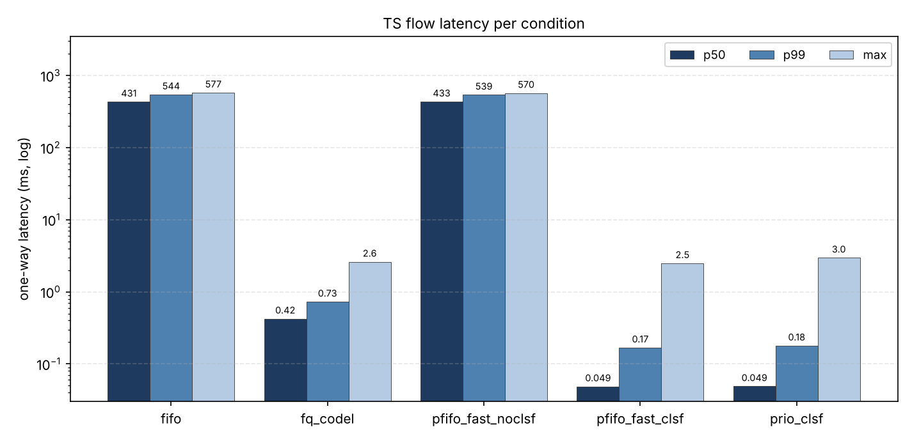
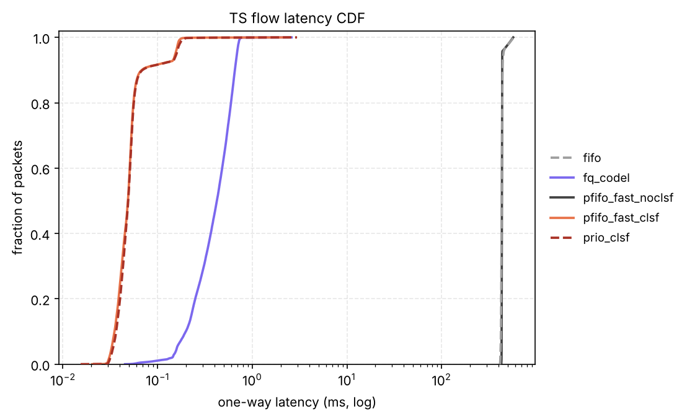

# eBPF time-sensitive 패킷 분류기

[](https://github.com/CometWoo/time_sensitive_packet/actions/workflows/ci.yml)
[](https://github.com/CometWoo/time_sensitive_packet/actions/workflows/testbed.yml)

Wen et al., "A Time-Sensitive Cloud-Native Network Based on eBPF"(CSCWD 2024)를 재현하다가 시작한 프로젝트다.
컨테이너 안에서 붙인 우선순위는 호스트 qdisc 까지 가지 못했고, 그래서 분류 위치를 호스트 NIC egress 로 옮겨 다시 만들었다.
20 Mbit/s 병목이 꽉 찬 상태에서 같은 `pfifo_fast` 큐를 쓰는데도 TS 흐름의 p50 지연이 433 ms 에서 0.05 ms 로,
손실이 39% 에서 0 으로 줄었다.

## 문제

### veth 가 priority 를 지운다

veth 를 건너는 패킷은 `____dev_forward_skb()`(`include/linux/netdevice.h`)에서 `skb->priority = 0` 이 된다.
컨테이너 안에서 `SO_PRIORITY` 를 주든 BPF 로 바꾸든 호스트 qdisc 가 보는 값은 0 이다. 테스트베드에서 프로브로 재 보면
talker 가 6 을 줬는데도 veth 를 막 건넌 패킷(런마다 52,858~52,864개)이 전부 priority 0 이었다.

### tcx 가 legacy tc 필터를 건너뛴다

kernel 6.6 부터 `sch_handle_egress()` 는 tcx 체인이 `TC_ACT_UNSPEC` 이 아닌 값을 돌려주면 `tc_run()` 을 부르지 않는다.
Cilium 의 프로그램은 통과시킬 패킷에 `TC_ACT_OK` 를 돌려주므로, 그 뒤에 `tc filter ... bpf` 로 붙인 분류기에는
패킷이 아예 오지 않는다.
CI 의 tcx 체인 테스트가 이 동작을 확인한다.

## 설계


`ts_classifier` 는 호스트 NIC egress, 패킷이 qdisc 에 들어가기 직전에 붙는다.

1. UDP 6000, AVTP EtherType, VLAN PCP 5 이상을 TS 로 본다. 나머지 패킷의 priority 는 건드리지 않는다.
2. TS 패킷에 `skb->priority = 6` 을 준다. `prio`/`pfifo_fast` 기본 priomap 에서 band 0 이다.
3. IPv4 면 DSCP 를 46(EF)으로 바꾸고 헤더 체크섬을 증분 갱신한다. `skb->priority` 는 호스트를 떠나면 사라지고,
   스위치가 읽을 수 있는 건 DSCP 다.
4. tcx 에서는 체인 맨 앞(`BPF_F_BEFORE`)에 붙고 항상 `TC_ACT_UNSPEC` 을 돌려준다. 뒤에 있는 Cilium 같은 프로그램도
   그대로 실행된다.

## 테스트베드

한 호스트에 netns 두 개를 만들어 컨테이너, veth, 호스트, NIC 로 이어지는 경로를 흉내 냈다. 송신 netns 에서 1 ms 간격
128 B TS 흐름(UDP 6000)과 30 Mbit/s best-effort flood(UDP 5001)를 같이 보내고, NIC 역할을 하는 `vr_host` 에
20 Mbit/s `tbf` 병목을 걸어 큐가 계속 차 있게 했다. 병목 아래 qdisc 만 바꿔 가며 다섯 조건을 비교한다.
여기에는 Cilium 이 없어서 분류기를 legacy tc(clsact)로 붙였고, tcx 순서는 체인 테스트로 따로 확인한다.

| 조건 | 병목 아래 qdisc | 분류기 |
|---|---|---|
| `fifo` | pfifo | 없음 |
| `fq_codel` | fq_codel | 없음 |
| `pfifo_fast_noclsf` | pfifo_fast (3-band) | 없음 |
| `pfifo_fast_clsf` | pfifo_fast (3-band) | 있음 |
| `prio_clsf` | prio, bands 3 | 있음 |

## 결과

GitHub Actions 러너(kernel 6.17)에서 조건마다 3 run × 10,000 패킷을 보냈다. 원본 CSV 는
[results/testbed/ci-34294518788](results/testbed/ci-34294518788) 에 있고, 표의 숫자는
`analysis/tests/test_integration.py` 가 고정한다.

| 조건 | p50 (ms) | p99 (ms) | 손실 | 수신 DSCP |
|---|---|---|---|---|
| `fifo` | 431.33 | 543.73 | 35.18% | 0 |
| `fq_codel` | 0.42 | 0.73 | 0 | 0 |
| `pfifo_fast_noclsf` | 433.15 | 538.89 | 38.96% | 0 |
| `pfifo_fast_clsf` | 0.05 | 0.17 | 0 | 46 |
| `prio_clsf` | 0.05 | 0.18 | 0 | 46 |

| latency 백분위 | latency CDF |
|---|---|
|  |  |

- 3-band 큐가 있어도 priority 가 오지 않으면 소용이 없다. `pfifo_fast_noclsf` 는 `fifo` 와 같은 430 ms 대에 머문다.
- 같은 `pfifo_fast` 에 분류기만 붙이면 p50 이 약 8,900배 줄고 손실이 0 이 된다
  (`fifo` 대비 Mann-Whitney U p < 1e-300, Cliff's δ = 1.00).
- NIC egress 프로브로 보면 분류기를 붙인 런마다 정확히 10,000개가 priority 6 이었고, 수신 측에도 30,000개 모두
  DSCP 46 으로 도착했다. 체크섬을 잘못 고쳤다면 수신 커널이 버렸을 패킷들이다.
- `fq_codel` 도 손실은 0 이지만 p99 가 0.73 ms 로 strict priority(0.17 ms)의 4배다. 흐름을 나눠 줄 뿐 패킷에
  표시를 남기지 않으니 호스트를 떠나면 우대도 끝난다.

jitter, 부트스트랩 CI, 런별 p99 까지 담은 전체 통계:
[summary.md](results/testbed/ci-34294518788/report/summary.md)

## 검증

| 대상 | 방법 |
|---|---|
| 분류 규칙, DSCP 와 체크섬, 설정 map | `BPF_PROG_TEST_RUN` 단위 테스트 25개 |
| tcx 체인 순서 | `bpf/tests/test_tcx_chain.sh` (kernel ≥ 6.6) |
| veth 리셋, DSCP 도착, 경합 아래 지연 | netns 테스트베드. `bpf/`, `workload/`, `testbed/` 를 바꾸는 PR 마다 CI 에서 돈다 |
| 통계 코드와 위 표의 숫자 | pytest 60개 |

실제 Cilium 다중 노드 클러스터에서는 아직 재지 않았다.

## 실행

```bash
make -C bpf && make -C bpf tools
sudo make -C bpf test        # BPF_PROG_TEST_RUN 단위 테스트
sudo make -C bpf test-tcx    # tcx 체인 (kernel >= 6.6)
sudo bash testbed/run.sh --runs 3 --out testbed/runs/local
pip install -e ./analysis
tsn-analysis summary testbed/runs/local --baseline fifo
```

## 구조

```
bpf/        분류기, priority 프로브, tcx 로더와 테스트
workload/   talker, listener, best-effort flood, sink
testbed/    netns 토폴로지와 실행 스크립트
analysis/   통계와 그래프 (tsn-analysis)
results/    CI 테스트베드 원본 CSV 와 리포트
```

## 참고

- J. Wen, J. Ge, Z. Zhang, H. Li, Y. E, B. Wu, "A time-sensitive cloud-native network based on eBPF," Proc. 27th
  IEEE CSCWD, 2024, pp. 2577–2582. DOI: [10.1109/CSCWD61410.2024.10580477](https://doi.org/10.1109/CSCWD61410.2024.10580477)
- Linux: `include/linux/netdevice.h` (`____dev_forward_skb`), `net/core/dev.c` (`sch_handle_egress`),
  `kernel/bpf/mprog.c`
