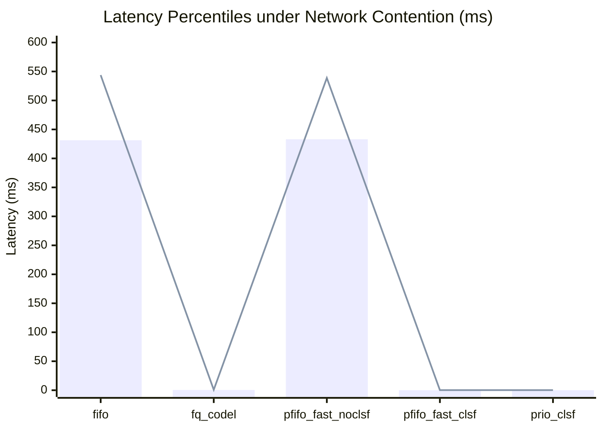

# Time-Sensitive Cloud-Native Network on eBPF — 재현, 반증, 재설계

[](https://github.com/CometWoo/time_sensitive_packet/actions/workflows/ci.yml)
[](https://github.com/CometWoo/time_sensitive_packet/actions/workflows/testbed.yml)
[English summary](README.en.md) · [설계 결정 기록(ADR)](docs/adr/README.md) · [결과](docs/RESULTS.md) · [한계](docs/LIMITATIONS.md) · [AIDC 연결](docs/AIDC_RELEVANCE.md)

> Reproducing Wen et al., "A Time-Sensitive Cloud-Native Network Based on eBPF" (CSCWD 2024) on Cilium/Kubernetes —
> and discovering, from kernel source and measurement, why the first reproduction could not have worked:
> `skb->priority` is zeroed on every veth crossing, and Cilium's tcx programs hide legacy clsact filters.
> The redesign classifies at the host NIC egress via a tcx link placed before Cilium, marks DSCP for the fabric,
> and is verified by 26 BPF_PROG_TEST_RUN unit tests, a tcx-ordering integration test, and a contention testbed
> that runs in CI (p50 433 ms / 35 % loss → 0.05 ms / 0 loss).

## 프로젝트 상태 개요

초급 engineer가 이 프로젝트를 처음 볼 때 가장 먼저 알아야 할 사실은 두 시점의 서로 다른 데이터가 공존한다는 점입니다. 초기 실험의 오류를 발견하고 이를 바로잡는 과정 자체가 본 프로젝트의 핵심 엔지니어링 기록입니다.

| 구분 | 설명 |
|---|---|
| 유효한 결과 | 2026-09 netns testbed 환경, GitHub Actions runner Linux kernel 6.17, 20 Mbit/s 병목 queue 및 30 Mbit/s best-effort background traffic 경합 하에서 도출한 실측치입니다. 상세 데이터는 results/testbed/ci-34294518788 디렉토리에 보존되어 있습니다. |
| 재해석한 결과 | 2026-05 VirtualBox 2-VM Kubernetes 환경에서 수집한 9개 CSV 데이터입니다. 측정 당시 우선순위 전달 메커니즘이 동작하지 않았음을 사후 분석으로 확인하였으며, 실패 분석 자료로 보존하고 있습니다. 상세 내용은 docs/RESULTS.md 2절을 참조하십시오. |
| 미검증 상태 | 재설계한 eBPF classifier를 실제 다중 노드 Cilium cluster에 적용한 실측은 아직 수행되지 않았습니다. 단일 host netns 및 CI 환경 검증은 완료되었으나 클라우드 가상 머신 환경의 검증은 후속 과제로 남아 있습니다. 상세 내용은 docs/VERIFICATION.md를 참조하십시오. |

## 프로젝트 한눈에 보기

초급 engineer의 이해를 돕기 위해 프로젝트의 핵심 구축물, 발견 사항, 배운 원리를 기술적 관점에서 풀어서 정리합니다.

- 개발한 핵심 요소
  - host 물리 NIC egress 계층에 부착되는 eBPF packet classifier `ts_classifier`: AVTP protocol, IEEE 802.1Q/802.1ad PCP, 지정된 UDP port(예: 6000)를 식별하여 `skb->priority` 값을 6으로 지정하고 DSCP EF(46) 값을 marking하며 IPv4 header checksum을 증분 갱신합니다.
  - libbpf 기반 tcx loader 도구 `tools/tcx_attach.c`: CNI 프로그램 실행 전에 먼저 실행되도록 `BPF_F_BEFORE` flag를 적용하여 attach합니다.
  - 단일 host 기반의 가상 network namespace testbed `testbed/`: Pod, veth interface, host routing, NIC bottleneck queue를 정밀하게 모사합니다.
  - 통계 분석 패키지 `tsn-analysis`: bootstrap 신뢰구간, Mann-Whitney U 검정, Cliff's delta 효과 크기 계산 및 CDF 시각화 기능을 제공합니다.

- 커널 소스 분석을 통해 발견한 사실
  - Linux kernel 내부의 `include/linux/netdevice.h` 파일 내 `____dev_forward_skb()` 함수는 container와 host를 잇는 veth interface를 통과하는 모든 packet의 `skb->priority` 값을 0으로 강제 초기화합니다. 따라서 container 내부에서 `SO_PRIORITY` socket option이나 eBPF로 우선순위를 지정하더라도 host qdisc 계층에는 전혀 전달되지 않습니다.
  - Linux kernel 6.6 이상에서 도입된 tcx framework 환경에서 Cilium의 CNI datapath 프로그램이 `TC_ACT_OK`를 반환하면 그 뒤에 등록된 기존 legacy clsact tc filter는 호출되지 않고 건너뜁니다.
  - 2026년 5월 초기 실험 환경에는 queue 경합을 유발하는 network background traffic이 없었으며, 송신 애플리케이션(talker)이 packet 송신마다 DNS 질의를 반복하여 정상적인 1 ms pacing을 유지하지 못했습니다.

- 도출한 핵심 엔지니어링 원리
  - packet 우선순위 지정은 어느 위치에서 값을 설정하느냐가 결과를 좌우합니다. host 경계를 벗어나 fabric 스위치로 전달되는 신호는 L3 DSCP 및 L2 PCP 필드뿐입니다.
  - queue 내부에서 경합(contention)이 발생하지 않으면 traffic scheduling 및 QoS 제어의 효과를 측정할 수 없습니다.
  - 단순 latency 지표 표를 신뢰하기 전에 eBPF per-CPU counter, 커널 내부 probe, 실제 송신 pacing 품질을 먼저 검증해야 합니다.

## 핵심 벤치마크 결과 비교

GitHub Actions CI runner(Linux kernel 6.17) 환경에서 20 Mbit/s tbf bottleneck queue와 30 Mbit/s best-effort UDP flood(1400 byte packet) 경합 조건 하에서 조건당 3회 반복(총 30,000 packet) 측정한 결과입니다.

| 조건명 | eBPF 분류기 | latency p50 (ms) | latency p99 (ms) | packet 손실률 | 수신 DSCP | 동작 분석 |
|---|---|---|---|---|---|---|
| fifo (pfifo) | 없음 | 431.33 | 543.73 | 35.18 % | 0 | 우선순위 구분 없는 기본 FIFO queue로 심각한 tail latency와 drop 발생 |
| fq_codel | 없음 | 0.42 | 0.73 | 0.00 % | 0 | Linux 배포판 기본 flow 공정 queue가 저속 stream을 자동 우대 |
| pfifo_fast_noclsf | 없음 | 433.15 | 538.89 | 38.95 % | 0 | 우선순위가 도달하지 않아 3-band queue임에도 fifo와 동일하게 동작 |
| pfifo_fast_clsf | 적용 | 0.05 | 0.17 | 0.00 % | 46 (EF) | 커널 기본 qdisc 환경에서 TS packet을 band 0으로 최우선 처리 |
| prio_clsf | 적용 | 0.05 | 0.18 | 0.00 % | 46 (EF) | 3-band strict priority queue에서 실시간 packet 최우선 dequeue 처리 |



통계적 분석 결과, fifo 대비 pfifo_fast_clsf 조건의 p99 latency는 99.97% 개선되었으며, Mann-Whitney U 검정 p < 1e-300, Cliff's delta = +1.00으로 통계적 유의성이 검증되었습니다. 반면 분류기가 없는 pfifo_fast_noclsf 조건은 fifo 조건과 통계적으로 동일한 분포를 보였습니다(Cliff's delta = -0.22).

kernel 내부 probe인 `prio_probe` 측정 결과, veth를 통과한 직후 host interface ingress에서는 52,858개 packet 전체의 priority가 0이었으며, NIC egress의 `ts_classifier` 통과 후 10,000개의 TS packet에 priority 6이 정상 부여되었습니다.

| 지연 시간 백분위 비교 | 지연 시간 누적 분포 함수 (CDF) |
|---|---|
|  |  |

상세한 수치 및 통계 데이터는 [docs/RESULTS.md](docs/RESULTS.md)에서 확인할 수 있습니다.

## 아키텍처


세부(커널 함수·줄 번호, v1 대비 표): [docs/ARCHITECTURE.md](docs/ARCHITECTURE.md). 논문 요소 대응: [docs/PAPER_MAPPING.md](docs/PAPER_MAPPING.md).

### 단계별 상세 동작 원리

1. Container 송신 계층: talker 애플리케이션이 1 ms 간격으로 128 byte의 UDP packet을 생성합니다. container 내부에서 socket option `SO_PRIORITY`를 지정하더라도 후속 커널 계층에서 무효화됩니다.
2. Kernel veth 포워딩 계층: container의 eth0에서 송신된 packet은 kernel 내부 함수 `drivers/net/veth.c:veth_forward_skb()`를 통해 `include/linux/netdevice.h:____dev_forward_skb()`로 전달됩니다. 이 함수는 보안 격리를 목적으로 `skb->priority = 0` 명령을 무조건 실행합니다.
3. CNI 수신 계층: host 측 veth interface에 연결된 Cilium 프로그램 `cil_from_container`가 packet을 수신하여 물리 NIC로 redirect합니다.
4. Host NIC Egress 분류 계층: 물리 interface의 `sch_handle_egress()` 위치에서 Cilium 프로그램보다 앞선 tcx 체인 맨 앞(`BPF_F_BEFORE`)에 등록된 `ts_classifier`가 실행됩니다. UDP destination port가 6000인 packet을 감지하여 `skb->priority = 6`으로 설정하고 IP header의 DSCP 필드를 46(Expedited Forwarding)으로 갱신한 뒤 `TC_ACT_UNSPEC`을 반환합니다.
5. Cilium Egress 및 qdisc 계층: 뒤이어 Cilium 프로그램이 정책 검사를 수행하고 `TC_ACT_OK`를 반환하면 커널의 queueing discipline 계층으로 진입합니다. `prio` 또는 `pfifo_fast` qdisc는 `skb->priority` 6 값을 인식하여 band 0(최상위 큐)에 packet을 enqueue하고 최우선으로 내보냅니다.
6. 수신 및 검증 계층: packet header에 DSCP 46 값이 보존되어 물리 wire를 통과하며, 수신측 listener는 `IP_RECVTOS` option을 통해 DSCP 값이 변조 없이 정상 도착했는지 확인합니다.

상세 아키텍처 분석은 [docs/ARCHITECTURE.md](docs/ARCHITECTURE.md)를 참조하십시오.

## 아키텍처 설계 결정 기록 (ADR 요약)

프로젝트를 진행하며 직면한 핵심 기술적 난제들과 이를 해결하기 위해 내린 결정들의 요약입니다.

| 번호 | 결정 항목 | 검토한 기술 대안 | 최종 선택 이유 | 관련 문서 |
|---|---|---|---|---|
| 0001 | 가상 머신 기반 환경 선택 | 실제 TSN 지원 물리 NIC vs VirtualBox VM | 장비 예산 제약 속에서 kernel 내부 메커니즘을 netns 및 CI testbed로 완벽히 검증 가능 | [ADR-0001](docs/adr/0001-virtualbox-vms-instead-of-physical-tsn-nics.md) |
| 0002 | qdisc 단순화 | mqprio, ETF, taprio vs 소프트웨어 prio/pfifo_fast | 가상화 1개 TX queue 환경의 한계 극복 및 SO_TXTIME 미지원 packet drop 방지 | [ADR-0002](docs/adr/0002-prio-instead-of-mqprio-etf-taprio.md) |
| 0003 | packet 분류 지점 확정 | Pod 내부 eth0 vs host veth vs host 물리 NIC egress | veth 통과 시 priority가 0으로 리셋되므로 qdisc 직전인 물리 NIC egress가 유일한 유효 지점 | [ADR-0003](docs/adr/0003-classify-at-host-nic-egress.md) |
| 0004 | 비실시간 트래픽 보존 | 비 TS packet priority 강제 강등 vs 불변 유지 | 관찰자 원칙 준수 및 background traffic의 왜곡 방지 | [ADR-0004](docs/adr/0004-non-ts-priority-untouched.md) |
| 0005 | Cilium과의 tcx 공존 | legacy clsact vs tcx AFTER vs tcx BEFORE | Cilium이 OK를 반환하면 legacy 필터가 생략되므로 tcx BEFORE 등록 및 UNSPEC 반환 채택 | [ADR-0005](docs/adr/0005-tcx-before-cilium.md) |
| 0006 | 경합 환경 강제 조성 | CPU 부하만 인가 vs 병목 대역폭 제한 및 UDP flood | queue가 비어 있으면 우선순위 제어가 동작하지 않으므로 tbf 20M + flood 30M 필수 적용 | [ADR-0006](docs/adr/0006-testbed-needs-contention.md) |
| 0007 | DSCP 마킹 도입 | host 내부 skb->priority 전용 vs IP header DSCP 46 마킹 | host 외부 물리 스위치 fabric으로 우선순위를 전달하기 위해 DSCP EF 마킹 필수 | [ADR-0007](docs/adr/0007-dscp-marking-for-fabric-qos.md) |
| 0008 | 송신측 DNS 제거 | packet마다 getaddrinfo 호출 vs 1회 주소 해석 후 캐싱 | 매 packet마다 DNS 통신이 발생하여 지연 시간에 수십 ms 노이즈가 섞이는 문제 해결 | [ADR-0008](docs/adr/0008-talker-resolve-once.md) |
| 0009 | BPF 바이너리 정책 | 사전 빌드된 .o 파일 commit vs CI 기반 실시간 빌드 | 소스 코드와 바이너리 불일치 방지 및 kernel verifier 적합성 자동 검증 | [ADR-0009](docs/adr/0009-no-prebuilt-bpf-binaries.md) |
| 0010 | 5개 실험 대조군 설계 | proposed/baseline 2개 vs 5개 독립 조건 | qdisc 자체의 특성과 priority 전달 여부의 인과 관계를 완벽히 분리 | [ADR-0010](docs/adr/0010-qdisc-conditions.md) |
| 0011 | 우선순위 6 매핑 | priority 3 + 커스텀 맵 vs priority 6 + 기본 priomap | 비특권 container 권한 상한(6) 준수 및 기본 priomap의 band 0 자동 매핑 활용 | [ADR-0011](docs/adr/0011-priority-6-default-priomap.md) |
| 0012 | 시계 오차 보정 | VM 간 PTP 의존 vs 동일 host 단일 시계 testbed | VM 간 수십 ms 시계 offset 문제를 해결하여 절대 단방향 지연 시간 유효성 확보 | [ADR-0012](docs/adr/0012-clock-skew-and-same-host-testbed.md) |
| 0013 | 배포 파이프라인 관리 | Docker 이미지 빌드 vs kustomize 기반 ConfigMap 주입 | container build 환경 의존성을 제거하고 원본 Python 소스 코드와의 일관성 유지 | [ADR-0013](docs/adr/0013-configmap-scripts-via-kustomize.md) |
| 0014 | 보안 신뢰 경계 정립 | 단순 L4 port 기반 vs 출발지 identity 검증 | L4 port 기반 분류의 테넌트 악용 한계를 명시하고 AIDC 환경 identity 기반 로드맵 제시 | [ADR-0014](docs/adr/0014-udp-port-classification-and-trust-boundary.md) |
| 0015 | 통계적 분석 엄밀성 | 단순 평균/점추정 vs bootstrap 신뢰구간 및 비모수 검정 | 롱테일 분포 특성을 반영하기 위해 Mann-Whitney U 및 Cliff's delta 통계 도입 | [ADR-0015](docs/adr/0015-statistics.md) |
| 0016 | 초기 측정 데이터 보존 | 오류 데이터 삭제 vs 실패 분석 데이터로 보존/재해석 | 메커니즘 미작동 원인을 밝혀낸 엔지니어링 교훈을 정직하게 보존 | [ADR-0016](docs/adr/0016-results-provenance.md) |

전체 16개 ADR의 상세 내용은 [docs/adr/README.md](docs/adr/README.md)에 정리되어 있습니다.

## 다각도 검증 결과 요약

| 검증 항목 | 검증 방식 및 도구 | 실행 환경 | 상태 |
|---|---|---|---|
| BPF packet 분류 규칙 | 26개 BPF_PROG_TEST_RUN 단위 테스트 (bpftool prog run) | Linux kernel 5.15 (WSL2), kernel 6.17 (CI runner) | 전체 통과 |
| tcx 실행 순서 및 체인 제어 | tcx 체인 통합 테스트 (test_tcx_chain.sh) | Linux kernel 6.17 (CI runner) | 전체 통과 |
| veth priority 리셋 실측 | prio_probe eBPF 히스토그램 추출 | netns testbed (CI runner, WSL2) | 실측 검증 완료 |
| DSCP 46 종단간 도달 | listener IP_RECVTOS socket 수신 확인 | netns testbed (30,000 packet) | 실측 검증 완료 |
| 경합 하 우선순위 큐 효과 | 5개 조건 × 3 run netns testbed 실험 | GitHub Actions CI runner | 실측 검증 완료 |
| 통계 패키지 신뢰성 | pytest 65개 단위 테스트 | Python 3.11/3.12 CI runner | 전체 통과 |
| CNI 실제 cluster 통합 | 다중 노드 Kubernetes 환경 자동화 script | scripts/experiment.sh | 미검증 (VM 환경 접근 불가) |

상세 검증 내역은 [docs/VERIFICATION.md](docs/VERIFICATION.md)를 참조하십시오.

## AI 데이터센터 네트워크(AIDC) 연계성

본 프로젝트에서 해결한 host 내부 packet 스케줄링 문제는 대규모 분산 딥러닝 cluster의 network 병목 현상과 밀접하게 맞닿아 있습니다.

- skb->priority와 DSCP의 역할 분담: host 내부 memory 구조체에만 존재하는 `skb->priority`는 NIC를 벗어나면 사라집니다. ToR 스위치와 spine 스위치로 구성된 data center fabric 전체에서 QoS를 유지하려면 IP header의 DSCP 필드에 Expedited Forwarding(EF, 46)을 정확히 마킹해야 합니다.
- Strict Priority와 꼬리 지연(Tail Latency): All-Reduce와 같은 분산 학습 집단 통신에서는 단 하나의 worker 노드 지연(straggler)이 전체 훈련 step 시간을 지연시킵니다. 본 프로젝트의 eBPF 기반 priority 처리는 background 트래픽 폭주 상황에서도 동기화 packet의 p99 지연 시간을 543 ms에서 0.17 ms로 단축할 수 있음을 입증했습니다.
- RoCEv2 및 CNI와의 공존: 초고속 RDMA network(RoCEv2)가 사용하는 PFC(Priority-based Flow Control) 및 ECN 혼잡 제어와 본 eBPF packet marking이 조화롭게 공존할 수 있는 기술적 청사진을 제공합니다.

세부 연계 분석은 [docs/AIDC_RELEVANCE.md](docs/AIDC_RELEVANCE.md)를 참조하십시오.

## 프로젝트 빠른 시작 (Quick Start)

로컬 환경에서 코드를 직접 빌드하고 검증해볼 수 있는 표준 명령어 가이드입니다.

```bash
# 1. eBPF 소스 빌드 및 단위 테스트 실행 (Linux root 권한 필요)
make -C bpf
make -C bpf tools
sudo make -C bpf test          # 26개 BPF_PROG_TEST_RUN 단위 테스트 실행
sudo make -C bpf test-tcx      # Linux kernel 6.6 이상 환경에서 tcx 체인 검증

# 2. 단일 host netns testbed 경합 실험 실행
# tbf 20 Mbit/s 병목 queue 및 30 Mbit/s background flood 환경에서 3회 반복
sudo bash testbed/run.sh --runs 3 --rate-mbps 20 --flood-mbps 30 --out testbed/runs/local

# 3. 통계 분석 및 시각화 그래프 생성
python -m pip install -e ./analysis
tsn-analysis summary testbed/runs/local --baseline fifo --markdown -
tsn-analysis plot testbed/runs/local --out figures/

# 4. Kubernetes 다중 노드 클러스터 실험 준비
cp experiment.env.example experiment.env
sudo bash scripts/experiment.sh build-ebpf
sudo bash scripts/experiment.sh deploy-k8s
```

실행 단계별 상세 가이드 및 문제 해결 방법은 [docs/RUNBOOK.md](docs/RUNBOOK.md)를 참조하십시오.

## 저장소 구조

```
time_sensitive_packet/
├── bpf/                # eBPF C 소스코드, tcx_attach 도구, 단위 테스트
│   ├── src/            # ts_classifier.c, prio_probe.c, tcx_dummy_ok.c
│   ├── tools/          # libbpf 기반 tcx_attach.c loader
│   └── tests/          # bpftool prog run 기반 단위 테스트 및 tcx 체인 검증 script
├── workload/           # 송수신 애플리케이션 (talker.py, listener.py, be_flood.py, udp_sink.py)
├── testbed/            # 단일 host netns 토폴로지 구성 및 자동화 runner (run.sh, topology.sh)
├── k8s/                # Kubernetes 매니페스트 (kustomization 기반 ConfigMap 주입)
├── scripts/            # 클러스터 오케스트레이션 및 설정 script (experiment.sh, verify.sh, setup/)
├── analysis/           # 통계 계산, 부트스트랩, 그래프 생성 Python 패키지 (tsn-analysis)
├── results/            # 실측 CSV 데이터 및 리포트 (k8s-2026-05, testbed/ci-34294518788)
├── docs/               # 상세 기술 문서 및 설계 결정 기록 (ADR 16개 포함)
├── CHANGELOG.md        # 버전별 변경 이력 기록
└── README.md           # 프로젝트 메인 대문 문서
```

## 참고 문헌

- J. Wen, J. Ge, Z. Zhang, H. Li, Y. E, B. Wu, "A time-sensitive cloud-native network based on eBPF," Proc. 27th IEEE International Conference on Computer Supported Cooperative Work in Design (CSCWD), 2024, pp. 2577–2582. DOI: [10.1109/CSCWD61410.2024.10580477](https://doi.org/10.1109/CSCWD61410.2024.10580477)
- Linux Kernel Source: `include/linux/netdevice.h` (`____dev_forward_skb`), `net/core/dev.c` (`sch_handle_egress`), `kernel/bpf/mprog.c`
- Cilium eBPF Datapath Documentation: [https://docs.cilium.io](https://docs.cilium.io)
고용) · ci/
analysis/       tsn_analysis 패키지 (loader/metrics/stats/plots/report/cli) + tests
results/        testbed/ (CI 실측: CSV · meta.json · report) · k8s-2026-05/ (5월 K8s 데이터 + 그래프, 재해석용)
docs/           ARCHITECTURE · RESULTS · LIMITATIONS · VERIFICATION · DATA_PROVENANCE · PAPER_MAPPING · AIDC_RELEVANCE · RUNBOOK · adr/
.github/        ci.yml (lint · bpf · analysis) · testbed.yml (실험 → 아티팩트)
Makefile · experiment.env.example · CHANGELOG.md · LICENSE
```

## 로드맵

1. VM 클러스터에서 `scripts/experiment.sh matrix` 실행 → `results/k8s/` (veth 리셋·DSCP 를 Cilium 경로에서 재확인)
2. 출발지 identity 기반 분류(신뢰 경계), IPv6 Traffic Class
3. 물리 NIC: `mqprio hw`, XPS/IRQ affinity, isolcpus, 하드웨어 PTP + `SO_TIMESTAMPING`
4. 스위치 QoS(trust DSCP, strict-priority 큐)와 RoCE/PFC 클래스 공존 실험

## 참고

- J. Wen, J. Ge, Z. Zhang, H. Li, Y. E, B. Wu, "A time-sensitive cloud-native network based on eBPF," *Proc. 27th IEEE CSCWD*, 2024, pp. 2577–2582. DOI 10.1109/CSCWD61410.2024.10580477
- Linux: `include/linux/netdevice.h` `____dev_forward_skb`, `net/core/dev.c` `sch_handle_egress`, `kernel/bpf/mprog.c`, `net/sched/sch_prio.c`, `net/sched/sch_etf.c`
- Cilium datapath / tcx: https://docs.cilium.io — 변경 이력: [CHANGELOG.md](CHANGELOG.md)
